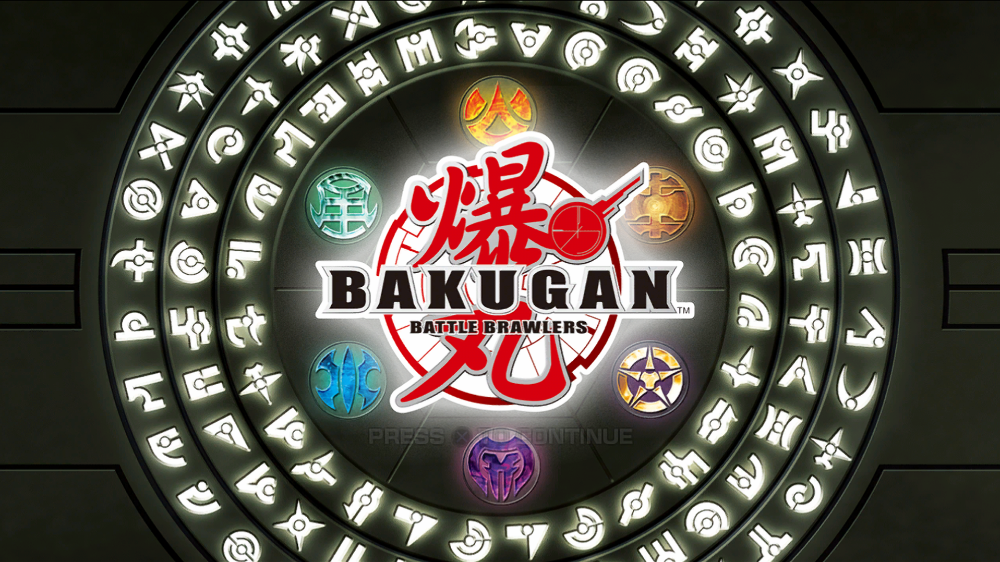
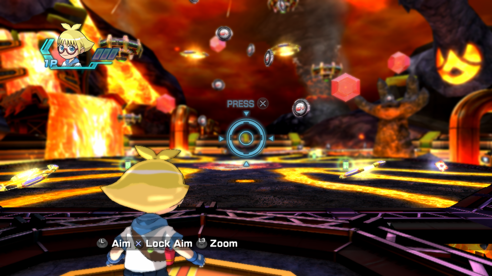
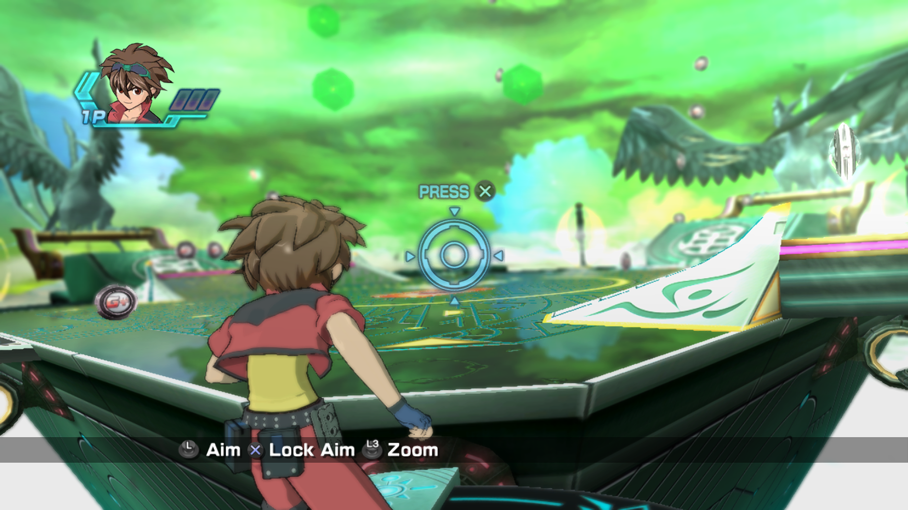

# Bakugan: Battle Brawlers — Recompilación Nativa de PS3 para Windows

<strong>El lanzamiento original de PlayStation 3 (<code>BLES00758</code>), recompilado estáticamente a un ejecutable nativo de Windows x64.</strong>

<a href="README.md"><strong>English Version</strong></a> · 
<a href="#requisitos-del-sistema">Requisitos del Sistema</a> · 
<a href="#instalación-y-cómo-jugar">Guía de Instalación</a> · 
<a href="#controles-y-sixaxis">Controles y Sixaxis</a> · 
<a href="#agradecimientos-y-créditos">Créditos</a>

---

## Galería de Capturas

### Pantalla Principal

### Arena de Batalla — Pyrus

### Arena de Batalla — Ventus

---

## Descripción del Proyecto

[Bakugan: Battle Brawlers](https://es.wikipedia.org/wiki/Bakugan:_Battle_Brawlers) (2009) se lanzó originalmente de manera exclusiva para consolas y nunca tuvo un port oficial de PC. Este proyecto recompila estáticamente el código binario **PPU (CPU)** y **SPU (DSP)** de la versión de PlayStation 3 a código C++ optimizado para Windows x64 utilizando el toolkit **[PS3Recomp](https://github.com/sp00nznet/ps3recomp)**, enlazado contra un runtime HLE que implementa las librerías del sistema sobre **Direct3D 12**, **WASAPI** e hilos nativos de Windows.

El juego es **completamente jugable de principio a fin**: modo historia, tutoriales, arenas de batalla, minijuegos de cartas, cinemáticas, videos FMV y sistema de guardado y carga funcionan de forma nativa.

---

## Características Principales en v1.0.0

- **Motor Direct3D 12 Nativo**: Renderizado acelerado por hardware con modo ventana sin bordes (*Borderless Windowed*) activado de manera predeterminada a 1080p, y opciones de reescalado (720p, 1080p, 1440p, 4K) con **AMD FidelityFX Super Resolution 1.0 (FSR1)** oficial y filtro de nitidez adaptativo (RCAS).
- **Controles Híbridos Simultáneos**: Juega en cualquier momento con mando (Xbox, DualShock 4/DualSense, Switch Pro, mandos genéricos XInput/DirectInput) o con Teclado y Ratón sin tener que cambiar opciones ni reiniciar el juego.
- **Simulación Tri-Modal de Sixaxis**: El control de dirección de la esfera en batalla admite 3 métodos simultáneos:
  1. **Movimiento del Ratón**: Mueve el ratón con naturalidad para inclinar y guiar la esfera Bakugan en la arena. Incorpora retorno al centro automático con amortiguación suave, filtro de ruido y captura/liberación de cursor al cambiar de ventana.
  2. **Stick Analógico Derecho**: Conducción suave e intuitiva para mandos convencionales.
  3. **Giroscopio Físico**: Soporte 1:1 de sensores de movimiento nativos en DualShock 4 y DualSense mediante SDL3.
- **Launcher Moderno y Bilingüe**: Incluye configurador visual de mando interactivo, ajustes gráficos, selección de idioma (Español e Inglés) y cierre automático al iniciar el juego para ahorrar recursos del equipo.
- **Instalador Automatizado Bilingüe**: Detecta el idioma de Windows (Español o Inglés), valida tu copia del disco europeo (`BLES00758`) y descifra automáticamente el `EBOOT.BIN` mediante utilidades portables de RPCS3.
- **Contenedor de Shaders Precargado (`fp_v3.cache`)**: Evita tirones de compilación de shaders al entrar a las arenas de combate.
- **Guardado Robusto**: Guardado multi-slot persistente almacenado en `%LOCALAPPDATA%\BakuganRecomp`.

---

## Requisitos del Sistema

| Componente | Requisitos Mínimos | Configuración Recomendada |
| :--- | :--- | :--- |
| **Sistema Operativo** | Windows 10 de 64 bits (Versión 1909+) o Windows 11 | Windows 10/11 de 64 bits (última actualización) |
| **Procesador (CPU)** | x86-64 con soporte de instrucciones AVX y SSE4.2 *(Intel Core 6ª gen / AMD Ryzen serie 1000)* | Procesador de 6 núcleos / 12 hilos o superior *(Intel Core i5-10400 / AMD Ryzen 5 3600 o más reciente)* |
| **Memoria (RAM)** | 4 GB de memoria RAM | 8 GB de memoria RAM o superior |
| **Tarjeta Gráfica (GPU)** | Compatible con Direct3D 12 Feature Level 11_0 *(NVIDIA GeForce GTX 960 / AMD Radeon RX 460 / Intel Iris Xe)* | Compatible con Direct3D 12 Feature Level 12_0 *(NVIDIA GeForce RTX 2060/3050 / AMD Radeon RX 6600 o mejor)* |
| **Almacenamiento** | 6 GB de espacio disponible (compatible con HDD) | 6 GB de espacio disponible en SSD de alta velocidad |
| **Sonido** | Tarjeta de sonido compatible con Windows / WASAPI | Auriculares o altavoces estéreo / multicanal |
| **Copia del Juego** | Copia legal del disco europeo original de PS3 (`BLES00758`) | Imagen `.iso` o carpeta `PS3_GAME` extraída |

---

## Requisito de Edición del Juego (Versión Europea)

> [!IMPORTANT]
> Esta recompilación requiere exclusivamente los archivos de la **versión europea en disco de Bakugan: Battle Brawlers (`BLES00758`)**.
> Otras ediciones regionales (como la americana `BLUS30409`) tienen direcciones binarias distintas y no son compatibles con esta versión de los lifts.

Debes proporcionar tu propia copia legal del disco europeo en formato **archivo ISO (`.iso`)** o una carpeta extraída que contenga `PS3_GAME/USRDIR/EBOOT.BIN`.

---

## Instalación y Cómo Jugar

1. Descarga el paquete completo de la versión **`Bakugan-Battle-Brawlers-Recomp-1.0-win64.zip`** desde la sección de [Último Lanzamiento](https://github.com/Mauryln/Bakugan-Battle-Brawlers-PS3-recomp/releases/latest).
2. Descomprime completamente el archivo ZIP en la carpeta que prefieras de tu equipo (asegúrate de que la carpeta `payload` permanezca al lado de `BakuganSetup.exe`).
3. Ejecuta **`BakuganSetup.exe`** desde la carpeta descomprimida.
4. Selecciona tu **archivo ISO europeo (`BLES00758`)** o directorio del juego.
5. Elige la carpeta donde deseas instalar y si prefieres accesos directos en el Escritorio o Menú Inicio.
6. Pulsa en **Instalar**. El instalador copiará los archivos de la aplicación, extraerá los recursos del disco y descifrará el ejecutable automáticamente.
7. Abre el juego desde el acceso directo creado o ejecutando **`BakuganLauncher.exe`**.
8. Ajusta la resolución, gráficos y controles a tu gusto en el launcher, y pulsa **Jugar**.

---

## Controles y Sixaxis

El puente de entrada permite combinar teclado, ratón y mandos simultáneamente.

### Asignación de Teclado y Ratón por Defecto

| Acción de PS3 | Tecla de Teclado / Ratón | Función en el Juego |
| :--- | :--- | :--- |
| **Cruz (✕)** | `X` o `Espacio` | Confirmar / Saltar / Acción principal |
| **Círculo (○)** | `C` | Cancelar / Retroceder |
| **Cuadrado (□)** | `Z` | Ataque / Carta de habilidad |
| **Triángulo (△)** | `S` | Especial / Carta de inicio |
| **Cruceta (D-Pad)** | Teclas de flecha (`↑`, `↓`, `←`, `→`) | Navegación por menús |
| **Start** | `Enter` | Menú de pausa |
| **Select** | `Retroceso` o `Tab` | Estado / Mapa / Detalles |
| **L1 / R1** | `Q` / `E` | Cambiar cartas / Zoom de cámara |
| **L2 / R2** | `1` / `2` | Acciones secundarias / Vista previa |
| **Stick Izquierdo** | `W`, `A`, `S`, `D` *(o mantener Clic Derecho)* | Desplazamiento y puntería del personaje |
| **Sixaxis (Conducción)** | **Movimiento del Ratón** *(o Flechas / Teclado numérico)* | Guiar la esfera Bakugan en la arena |

### Implementación del Sensor Sixaxis

En el título original de PS3, el lanzamiento y control de la esfera se realiza mediante la inclinación física del mando. En este port para PC, dispones de 3 alternativas simultáneas sin necesidad de activar selectores:

- **Conducción con Ratón**: Mueve el ratón para inclinar y guiar la esfera con precisión. Dispone de amortiguación elástica de retorno al centro para estabilizar la esfera sin deriva al soltar el ratón. El cursor se captura durante la partida y se libera automáticamente al alternar con Alt+Tab.
- **Stick Analógico Derecho**: En mandos estándar, inclina el stick derecho para girar la esfera con suavidad.
- **Giroscopio Físico**: Si conectas un mando DualShock 4 o DualSense, disfrutarás de movimiento 1:1 mediante los sensores integrados por SDL3.

---

## Detalles Técnicos

- **Recompilación Estática AOT**: 15.682 funciones de PPU y 1.331 de SPU compiladas a código máquina x64 nativo mediante LLVM clang-cl `/O2`.
- **Arquitectura de Subida Paralela**: Hilos de trabajo dedicados preparan y empaquetan vértices simultáneamente con la preparación de materiales en la CPU.
- **HLE Direct3D 12**: Traductor de command buffers de RSX con sincronización de swapchain nativa y aceleración de copias por filas NV3089.
- **Audio WASAPI de Baja Latencia**: Mezcla de flujos multicanal sincronizados con el reloj de audio del host.
- **Ubicación de Partidas**: `%LOCALAPPDATA%\BakuganRecomp\dev_hdd0\home\00000001\savedata`.

---

## Agradecimientos y Créditos

Este port no hubiera sido posible sin la comunidad de emulación y recompilación de código abierto:

- **Equipo de PS3Recomp y Ned Heller ([sp00nznet](https://github.com/sp00nznet) / [arnold9401](https://github.com/arnold9401))**:  
  Nuestro más sincero agradecimiento a los creadores del proyecto de recompilación estática **[PS3Recomp](https://github.com/arnold9401/ps3recomp)**. Su trabajo pionero en la traducción PPU/SPU y la arquitectura del runtime HLE hizo viable este proyecto.
- **Desarrolladores de RPCS3 ([rpcs3.net](https://rpcs3.net))**:  
  Por su extraordinario emulador y utilidades portables de descifrado utilizadas en la extracción de archivos del disco.
- **libsdl-org ([SDL3](https://github.com/libsdl-org/SDL))**:  
  Por el soporte multiplataforma de detección de mandos y lectura de sensores de movimiento.
- **AMD FidelityFX**:  
  Por FSR 1.0 (EASU) y el filtro de nitidez adaptativo (RCAS).

---

## Aviso Legal y Responsabilidad

Bakugan: Battle Brawlers es © de Activision, Nowpro, Nelvana, Spin Master y Sega Sammy.  
Este proyecto es una recreación independiente de código abierto y **no está afiliado, respaldado ni patrocinado por Sony Interactive Entertainment, Activision ni los titulares de los derechos**.

**NO SE DISTRIBUYEN ARCHIVOS PROTEGIDOS POR COPYRIGHT, CÓDIGO PROPIETARIO, CLAVES NI DATOS DEL JUEGO.**  
Los usuarios deben poseer y proporcionar su propia copia original del disco de PlayStation 3 en su edición europea (`BLES00758`).
