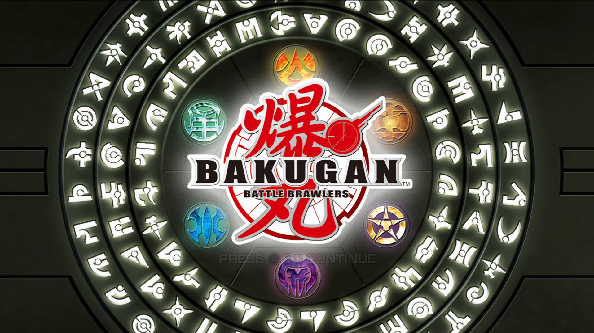
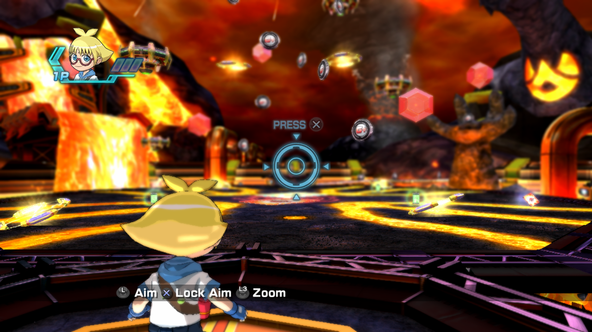
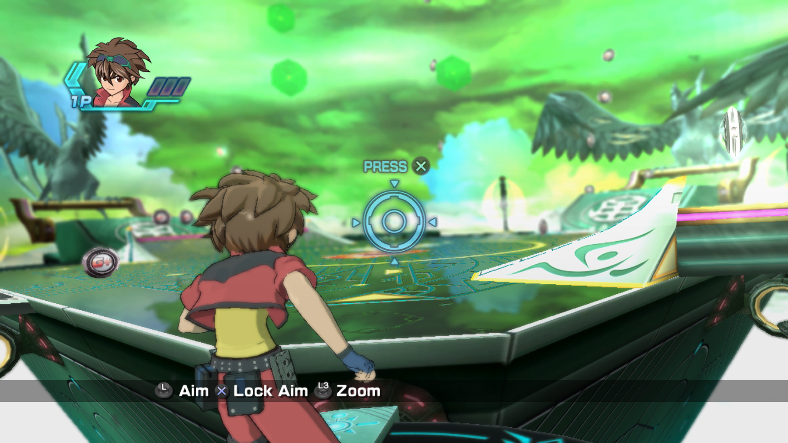

# Bakugan: Battle Brawlers — Recompilación Nativa de PS3 para Windows

<strong>El lanzamiento original de PlayStation 3 (<code>BLES00758</code>), recompilado estáticamente a un ejecutable nativo de Windows x64.</strong>

<a href="README.md"><strong>English Version</strong></a> · 
<a href="#novedades-y-correcciones-v136">Novedades (v1.3.6)</a> · 
<a href="#requisitos-del-sistema">Requisitos del Sistema</a> · 
<a href="#instalación-y-cómo-jugar">Guía de Instalación</a> · 
<a href="#controles-y-sixaxis">Controles y Sixaxis</a> · 
<a href="#agradecimientos-y-créditos">Créditos</a>

---

## Galería de Capturas

### Pantalla Principal

### Arena de Batalla — Pyrus

### Arena de Batalla — Ventus

---

## Descripción del Proyecto

[Bakugan: Battle Brawlers](https://es.wikipedia.org/wiki/Bakugan:_Battle_Brawlers) (2009) se lanzó originalmente de manera exclusiva para consolas y nunca tuvo un port oficial de PC. Este proyecto recompila estáticamente el código binario **PPU (CPU)** y **SPU (DSP)** de la versión de PlayStation 3 a código C++ optimizado para Windows x64 utilizando el toolkit **[PS3Recomp](https://github.com/sp00nznet/ps3recomp)**, enlazado contra un runtime HLE que implementa las librerías del sistema sobre **Direct3D 12**, **WASAPI** e hilos nativos de Windows.

El juego es **completamente jugable de principio a fin**: modo historia, tutoriales, arenas de batalla, minijuegos de cartas, cinemáticas, videos FMV, multijugador (hasta 7 puertos) y sistema de guardado y carga funcionan de forma nativa.

---

## Novedades y Correcciones (v1.3.6)

> Consulta las notas completas en [docs/RELEASE_1.3.6.md](docs/RELEASE_1.3.6.md), [docs/RELEASE_1.3.5.md](docs/RELEASE_1.3.5.md) y [docs/RELEASE_1.3.0.md](docs/RELEASE_1.3.0.md).
> **v1.3.6** es una actualización opcional de empaquetado sobre la v1.3.5 que elimina los falsos positivos de antivirus (**0/65** en VirusTotal en el ZIP y **0/70** en `BakuganSetup.exe`).

### Rendimiento D3D12 y Gráficos
- **AMD FSR 3.1 Frame Generation (Optical Flow)**: Interpolación de 30 FPS nativos hasta ~60 FPS presentados en arenas compatibles con **separación de HUD (`hudless`)**, manteniendo menús, cartas e interfaz nítidos y sin artefactos.
- **Antialiasing SMAA y Reescalado FSR 1**: Pipeline completo con **SMAA**, **AMD FSR 1.0 (EASU + nitidez RCAS configurable)** en salidas 720p / 1080p / 1440p / 4K, y **Filtrado Anisotrópico 16x** (con protección para texturas 2D).
- **Caché Unificada de Shaders y Optimizaciones de Pipeline**: Caché unificada en disco (`fp_v4` / `vs_v1`) en `%LOCALAPPDATA%\BakuganRecomp\shadercache`, búsquedas por tabla hash, **dirty tracking de SRVs** para omitir escrituras redundantes y **atlas de fuentes persistente** en los overlays.
- **Modos de Pantalla y Diagnóstico**: Modos nativos `windowed`, `borderless` y `fullscreen` DXGI con relación de aspecto **16:9 exacta**, alternancia instantánea entre ventana y sin bordes con **`F11`** y overlay de diagnóstico en tiempo real con **`F12`**.

### Pacing y Jugabilidad a 30 / 60 FPS
- **Corrección de Cuantización en 144 Hz**: Solucionado el fallo que limitaba el ritmo de fotogramas a 28.80 FPS en monitores de 144 Hz, clavando **30.00 FPS estables**.
- **30 FPS Nativos y Modo Opcional de 60 FPS**: Los 30 FPS nativos quedan fijos por defecto (con interpolación opcional FSR 3.1 hasta ~60 FPS visuales), manteniendo además soporte opcional de 60 FPS nativos (`PS3_FPS_CAP=60`) con la corrección del flanco de `Start` para que el **menú de opciones/pausa en batalla** sea totalmente funcional.

### Audio SPU / MultiStream / WASAPI
- **Aceleración SIMD SSSE3 (~12x)**: Núcleos de audio SPU con SSE float y acceso rápido SSSE3 al Local Store para MultiStream.
- **Limitador Dinámico de Picos (Soft-Knee Limiter)**: Evita clipping y distorsión durante combates intensos, acompañado de limpieza de slots huérfanos, de-click y amortiguación adaptativa de jitter.
- **Priorización de ACKs de SPU y Cierre Ordenado de FMV**: La priorización de ACKs del buzón SPU evita bloqueos en ráfagas rápidas de disparos, y los hilos de vídeo/audio se cierran de forma ordenada durante cinemáticas FMV y al salir del juego.

### Sixaxis, Launcher v1.3.6 e Instalador
- **Sixaxis y Controles Analógicos Refinados**: Emulación Sixaxis suavizada con **filtro EMA independiente de FPS**, zona muerta radial 2D, soporte calibrado para mandos con giroscopio real sin doble inclinación, **modo Híbrido** (corrige con el stick derecho incluso inclinando el mando), perfil **Rápido** por defecto y respuesta progresiva del stick izquierdo en diagonales.
- **Nuevo Launcher Oscuro Estilo Pyrus v1.3.6**: Interfaz bilingüe renovada (`BakuganLauncher.exe`) con mapa interactivo del mando (`assets/launcher/Control.png` / Launcher-Picture), persistencia fiel de `player.ini`, gestión inteligente de visibilidad/captura del cursor y diálogo de confirmación de salida con **`Esc`**.
- **Runtime Autocontenido e Instalador Nativo Limpio**: Usa el runtime dinámico de MSVC (`/MD`) con las DLLs oficiales **firmadas por Microsoft** incluidas junto a los ejecutables (sin necesidad de instalar VC++ Redistributable aparte) y AMD FidelityFX FSR 3.1 en DLLs dedicadas. `BakuganSetup.exe` usa APIs nativas Win32 (`virtdisk.dll` / `IShellLinkW`), protege partidas y `player.ini`, permite actualizar sin volver a copiar la ISO y reporta **0 detecciones** en VirusTotal.

---

## Requisitos del Sistema

| Componente | Requisitos Mínimos | Configuración Recomendada |
| :--- | :--- | :--- |
| **Sistema Operativo** | Windows 10 de 64 bits (Versión 1909+) o Windows 11 | Windows 10/11 de 64 bits (última actualización) |
| **Procesador (CPU)** | **x86-64 con soporte obligatorio de AVX2 y SSE4.1** *(Intel Core 4ª gen Haswell / AMD Ryzen serie 1000 o superior)* | Procesador de 6 núcleos / 12 hilos con AVX2 *(Intel Core i5-10400 / AMD Ryzen 5 3600 o más reciente)* |
| **Memoria (RAM)** | 4 GB de memoria RAM | 8 GB de memoria RAM o superior |
| **Tarjeta Gráfica (GPU)** | Compatible con Direct3D 12 Feature Level 11_0 *(NVIDIA GeForce GTX 960 / AMD Radeon RX 460 / Intel Iris Xe)* | Compatible con Direct3D 12 Feature Level 12_0 (para FSR 3.1 Frame Generation) *(NVIDIA GeForce RTX 2060/3050 / AMD Radeon RX 6600 o mejor)* |
| **Almacenamiento** | 6 GB de espacio disponible (compatible con HDD) | 6 GB de espacio disponible en SSD |
| **Sonido** | Dispositivo de audio compatible con Windows / WASAPI | Auriculares o altavoces estéreo / multicanal |
| **Dependencias de Runtime** | **Ninguna** (DLLs `/MD` firmadas por Microsoft incluidas; no requiere VC++ Redistributable) | — |
| **Copia del Juego** | Copia legal del disco europeo original de PS3 (`BLES00758`) | Imagen `.iso` o carpeta `PS3_GAME` extraída |

> [!NOTE]
> Los binarios Release se compilan con **SSE4.1** y **AVX2** activados para los kernels SPU de audio y cómputo. Los procesadores sin soporte para AVX2 o SSE4.1 no son compatibles con los binarios precompilados.

---

## Requisito de Edición del Juego (Versión Europea)

> [!IMPORTANT]
> Esta recompilación requiere exclusivamente los archivos de la **versión europea en disco de Bakugan: Battle Brawlers (`BLES00758`)**.
> Otras ediciones regionales (como la americana `BLUS30409`) tienen direcciones binarias distintas y no son compatibles con esta versión de los lifts.

Debes proporcionar tu propia copia legal del disco europeo en formato **archivo ISO (`.iso`)** o una carpeta extraída que contenga `PS3_GAME/USRDIR/EBOOT.BIN`.

---

## Instalación y Cómo Jugar

### Instalación Nueva
1. Descarga el paquete completo de la versión **`Bakugan-Battle-Brawlers-Recomp-1.3.6-win64.zip`** desde la sección de [Último Lanzamiento](https://github.com/Mauryln/Bakugan-Battle-Brawlers-PS3-recomp/releases/latest).
2. Descomprime completamente el archivo ZIP en la carpeta que prefieras (mantén la carpeta `payload` junto a `BakuganSetup.exe`).
3. Ejecuta **`BakuganSetup.exe`** desde la carpeta descomprimida.
4. Selecciona tu **archivo ISO europeo (`BLES00758`)** o carpeta `PS3_GAME` extraída.
5. Elige la carpeta de destino y accesos directos (Escritorio / Menú Inicio), y pulsa en **Instalar**.
6. Abre el juego desde el acceso directo o ejecutando **`BakuganLauncher.exe`**, configura gráficos y controles, y pulsa **Jugar**.

### Actualizar desde una Versión Anterior (v1.2.0 / v1.3.0 / v1.3.5)
1. Cierra el juego y `BakuganLauncher.exe`.
2. Descomprime el ZIP de la versión v1.3.6 y ejecuta **`BakuganSetup.exe`**.
3. Selecciona la carpeta donde ya lo tienes instalado y **deja el campo de la ISO en blanco**. El instalador actualizará los binarios y recursos del launcher reutilizando los datos del juego y conservando tus partidas guardadas y `player.ini`.

---

## Controles y Sixaxis

El puente de entrada admite hasta **7 puertos simultáneos** combinando Teclado, Ratón y Mandos (DualShock 4, DualSense, Nintendo Switch Pro, Xbox/XInput y mandos genéricos SDL3). Todos los controles se pueden reasignar visualmente desde **`BakuganLauncher.exe`**.

### Controles por Defecto (Teclado, Ratón y Atajos del Sistema)

| Acción de PS3 / Función | Tecla / Entrada por Defecto | Función en el Juego |
| :--- | :--- | :--- |
| **Cruz (✕)** | `X` *(o Clic Izquierdo del Ratón)* | Confirmar / Saltar / Acción principal |
| **Círculo (○)** | `C` | Cancelar / Retroceder |
| **Cuadrado (□)** | `Z` | Ataque / Carta de habilidad |
| **Triángulo (△)** | `S` | Especial / Carta de inicio |
| **Cruceta y Stick Izquierdo** | Teclas de flecha (`↑`, `↓`, `←`, `→`) | Navegación / Movimiento / Puntería |
| **Stick Derecho** | `I`, `J`, `K`, `L` | Cámara / Inclinación Sixaxis |
| **Impulso Sixaxis** | `F` | Impulso de lanzamiento Sixaxis |
| **Start** | `Enter` | Menú de pausa / opciones |
| **Select** | `Tab` | Estado / Mapa / Detalles |
| **L1 / R1** | `Q` / `E` | Cambiar cartas / Zoom de cámara |
| **L2 / R2** | `1` / `2` | Acciones secundarias / Vista previa |
| **L3 / R3** | `3` / `R` | Pulsación de sticks |
| **Conducción Sixaxis** | **Movimiento del Ratón** / Stick Derecho / Giroscopio | Guiar la esfera Bakugan en la arena |
| **Cambio de Pantalla** | `F11` | Alternar al instante Ventana ↔ Sin bordes |
| **Overlay de Diagnóstico** | `F12` | Mostrar métricas de FPS / frame-time / ajustes en tiempo real |
| **Confirmación de Salida** | `Esc` | Abrir diálogo de confirmación para salir |

### Implementación del Sensor Sixaxis

Tres métodos de control funcionan simultáneamente y pueden ajustarse desde `BakuganLauncher.exe` (con el perfil **Rápido** activo por defecto):

- **Conducción con Ratón**: Inclinación natural con suavizado EMA independiente de FPS, zona muerta radial y retorno elástico al centro. La captura del cursor se adapta automáticamente a menús, overlays y Alt-Tab.
- **Stick Analógico Derecho**: Control suave de 360° en mandos estándar, acompañado de puntería progresiva en el stick izquierdo.
- **Giroscopio Físico y Modo Híbrido**: Soporte calibrado de sensores mediante SDL3 en DualShock 4, DualSense y Switch Pro sin doble inclinación. En modo **Híbrido**, puedes corregir la trayectoria con el stick derecho aunque el mando siga inclinado.

---

## Detalles Técnicos

- **Recompilación Estática AOT**: 15.682 funciones de PPU y 1.331 de SPU compiladas a código máquina x64 nativo con LLVM `clang-cl` `/O2` y runtime CRT estático (`/MT`).
- **Rutas SPU Aceleradas por SIMD**: Helpers SPU con SSE4.1 / AVX2 y núcleos de audio MultiStream con SSSE3 y SSE float.
- **HLE Direct3D 12**: Traductor de command buffers RSX con subida paralela de vértices, dirty tracking de SRVs, caché unificada de shaders en disco (`fp_v4`/`vs_v1`), SMAA, AMD FSR 1.0 y AMD FSR 3.1 Frame Generation con separación de HUD.
- **Audio WASAPI de Baja Latencia**: Mezcla multicanal con limitador dinámico soft-knee, amortiguación adaptativa de jitter y priorización de ACKs SPU.
- **Ubicación de Partidas y Ajustes**: Partidas en `%LOCALAPPDATA%\BakuganRecomp\dev_hdd0\home\00000001\savedata`; ajustes en `%LOCALAPPDATA%\BakuganRecomp\player.ini`.

---

## Agradecimientos y Créditos

Este port no hubiera sido posible sin la comunidad de emulación y recompilación de código abierto:

- **Equipo de PS3Recomp y Ned Heller ([sp00nznet](https://github.com/sp00nznet) / [arnold9401](https://github.com/arnold9401))**:  
  Nuestro más sincero agradecimiento a los creadores del proyecto de recompilación estática **[PS3Recomp](https://github.com/arnold9401/ps3recomp)**. Su trabajo pionero en la traducción PPU/SPU y la arquitectura del runtime HLE hizo viable este proyecto.
- **Desarrolladores de RPCS3 ([rpcs3.net](https://rpcs3.net))**:  
  Por su emulador de PS3 y utilidades portables de descifrado utilizadas en la extracción de archivos del disco.
- **libsdl-org ([SDL3](https://github.com/libsdl-org/SDL))**:  
  Por el soporte multiplataforma de detección de mandos y lectura de sensores de movimiento.
- **AMD FidelityFX**:  
  Por FSR 1.0 (EASU + RCAS) y FSR 3.1 Frame Generation (Optical Flow).

---

## Aviso Legal y Responsabilidad

Bakugan: Battle Brawlers es © de Activision, Nowpro, Nelvana, Spin Master y Sega Sammy.  
Este proyecto es una recreación independiente de código abierto y **no está afiliado, respaldado ni patrocinado por Sony Interactive Entertainment, Activision ni los titulares de los derechos**.

**NO SE DISTRIBUYEN ARCHIVOS PROTEGIDOS POR COPYRIGHT, CÓDIGO PROPIETARIO, CLAVES NI DATOS DEL JUEGO.**  
Los usuarios deben poseer y proporcionar su propia copia original del disco de PlayStation 3 en su edición europea (`BLES00758`).
