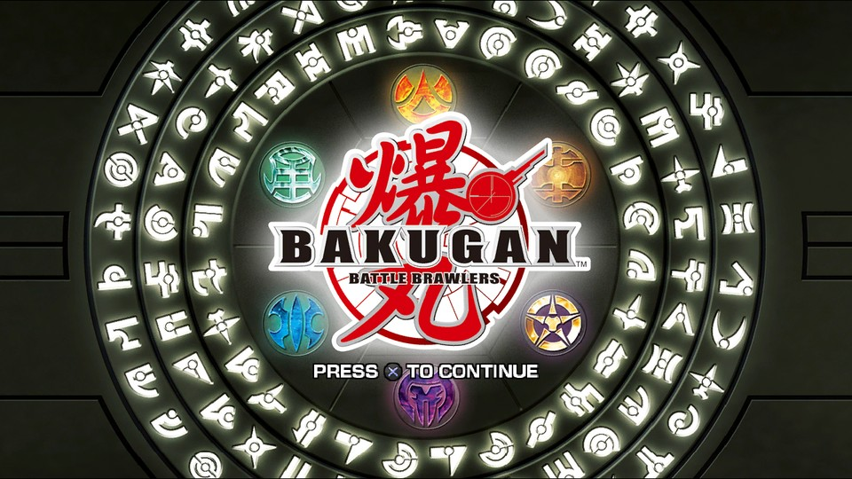
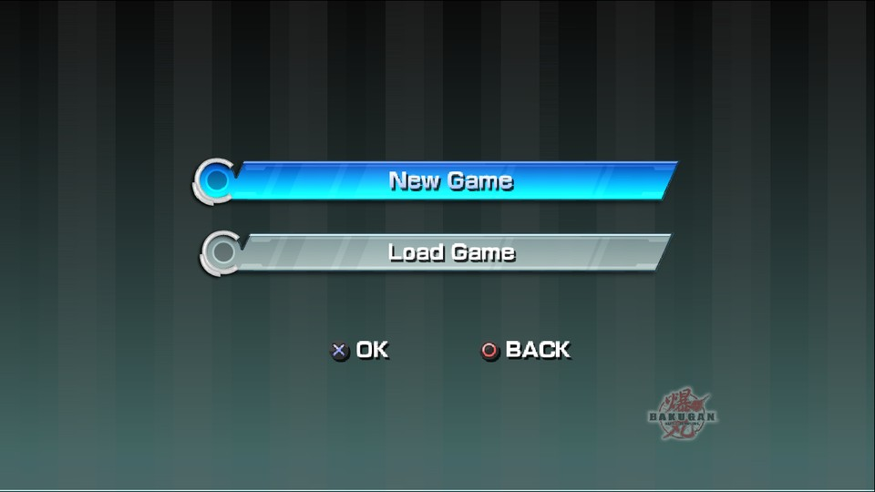
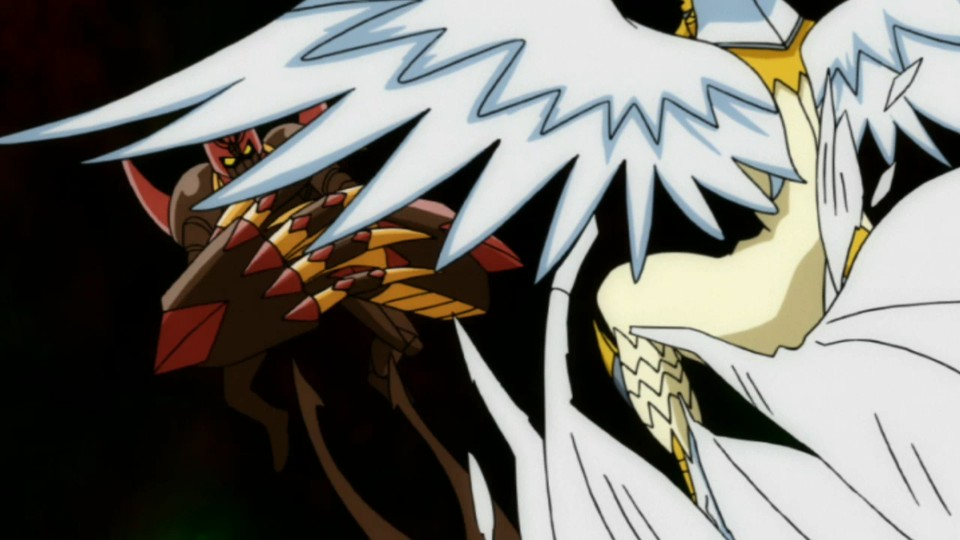

<div align="center">



<h1>Bakugan: Battle Brawlers — recompilación nativa de la versión PS3 para Windows</h1>

<p><strong>La versión de PlayStation 3 (<code>BLES00758</code>), recompilada estáticamente a un ejecutable nativo de Windows x64.</strong><br>
</p>

<p>


</p>

<p><a href="README.md">English</a> · <a href="docs/STATUS.md">Estado</a> · <a href="docs/ARCHITECTURE.md">Arquitectura</a> · <a href="docs/PERFORMANCE.md">Rendimiento</a></p>

</div>

> **06/11/2026 — gran mejora de rendimiento en batalla.** Las escenas de arena
> medidas alcanzan aproximadamente **27–28 FPS**, frente a la referencia anterior
> de **16–17 FPS**. Las copias coherentes por filas de NV3089 reducen trabajo CPU
> y conservan escenario, agua y HUD en las capturas revisadas.
> **Todavía no hay release:** faltan guardado y mapeo real del control; los 30 FPS
> sostenidos siguen pendientes. La última optimización aún no se validó en un
> duelo completo posterior al lanzamiento ni en todas las arenas.
> [Mejora medida](#mejoras-recientes-de-rendimiento) · [Estado](docs/STATUS.md).

[Bakugan: Battle Brawlers](https://es.wikipedia.org/wiki/Bakugan:_Battle_Brawlers) (2009) nunca salió en PC. Este proyecto levanta el código **PPU (CPU) y SPU (DSP)** del juego a C++ de forma estática con [ps3recomp](https://github.com/sp00nznet/ps3recomp) y lo enlaza contra un runtime HLE pequeño: el resultado es un `.exe` normal que dibuja por Direct3D 12. El juego completo es jugable; los menús van a 30 FPS y las escenas recientes de referencia en batalla rondan 27–28 FPS. Queda alcanzar 30 FPS sostenidos y reducir los tirones.

El código levantado se compila por adelantado; los trabajos SPU dinámicos sin imagen recompilada pueden usar el fallback del runtime.

| | |
|---|---|
|  |  |
| Flujo de título, aviso de guardado, carga, nueva partida / continuar | Intro narrativa — H.264/AAC con Media Foundation |

## Estado

| Hito | |
|---|---|
| Análisis del disco — 12.834 funciones OPD, 195 imports, 14 librerías | ✅ |
| Lift PPU — 15.682 funciones / 17 unidades de traducción | ✅ |
| Lift SPU — 5 imágenes, 1.331 funciones | ✅ |
| Tabla HLE — 1.204 handlers | ✅ |
| Build — clang-cl + Ninja + Direct3D 12 | ✅ |
| Assets — 607 trabajos de inflate descomprimidos en los SPU | ✅ |
| Logos de distribuidora — Activision, Nowpro, Premium Agency, Nelvana | ✅ |
| Apertura e intro narrativa — H.264/AAC con Media Foundation | ✅ |
| Pantalla de título, todos los menús, selector de modo, texturas 2D | ✅ |
| Teclado del juego (nombre) y pad de teclado/XInput | ✅ |
| Música — partituras PCM `SNDP` mezcladas en el SPU, más el AAC de los vídeos | ✅ |
| Battle Arena — turnos 1P/CPU, campo y cartas corregidos | ✅ |
| Historia y batallas jugables de principio a fin | ✅ |
| HUD, cartas, cinemáticas de personajes, sombras y reflejos | ✅ |
| *Defecto conocido:* el "gate" del selector de modo — las capas 2D tras el retrato se solapan | ⚠️ |
| **Rendimiento** — ~27–28 FPS en escenas de batalla medidas, frente a ~16–17 FPS históricos; 30 FPS sostenidos pendientes | ⚠️ |
| **Guardado** — cargar funciona, escribir la partida está incompleto | ❌ |
| **Control** — el pad XInput se simula, no se traduce desde la librería del juego | ❌ |
| **Efectos de sonido** — ATRAC3 en `SOUND/*.PAST` | ❌ |

**El juego es jugable de principio a fin. No habrá release hasta cerrar el guardado y el mapeo real del control; el rendimiento es el tercer bloqueo.**

## Mejoras recientes de rendimiento

La referencia histórica de 16–17 FPS y las observaciones recientes de 27–28 FPS
proceden de ejecuciones diferentes: muestran avance, no un porcentaje A/B.
La comparación aislada de NV3089 mantuvo **escena, personaje, cámara y proceso**,
alternando optimizado/original/optimizado:

| Camino | FPS | Tiempo medio por cuadro |
|---|---:|---:|
| Original | 23,09 | 43,31 ms |
| Optimizado, primera ventana | 27,27 | 36,67 ms |
| Optimizado, repetición | 27,05 | 36,97 ms |

Las ventanas optimizadas promedian **27,16 FPS / 36,82 ms**: aproximadamente
**15% menos tiempo por cuadro y 17,6% más FPS** en esa comparación. El trabajo
CPU de NV3089 bajó de **6,03 a 1,42 ms por flip**. Se conservan recorte, orden
hacia adelante en solapamientos y notificaciones de reservas SPU; los casos no
soportados mantienen el camino original. No se eliminaron draws, shaders ni
efectos deliberadamente para subir los FPS.

Las capturas conservaron la firma habitual de batalla (~1750 operaciones), con
geometría, personajes, agua y HUD visibles; el audio fue confirmado normal en
las pruebas revisadas. La validación es acotada: no demuestra equivalencia en
todas las arenas, cartas/efectos ni un duelo completo. **Aún no hay 30 FPS estables.**

Código reproducible: [parche 0051](patches/0051-nv3089-scaled-rows.patch).
`NV3089_SCALED_ROWS=0` antes de ejecutar restaura el camino original.
El test independiente cubre 10000 filas solapadas, 1000 blits recortados,
límites de direcciones y fallbacks de coherencia. No requiere toolkit ni datos del juego:

```powershell
.\tools\test_gcm_scaled_rows.ps1 -FromPatch
```

## Se busca ayuda

1. **Rendimiento.** Reducir tirones de carga y alcanzar 30 FPS sostenidos, conservando efectos y cuadros completos. Lo ya medido y lo descartado está en [`docs/PERFORMANCE.md`](docs/PERFORMANCE.md).
2. **Guardado.** Cargar una partida funciona; escribirla está incompleto.
3. **Control.** El pad se simula desde el camino del teclado en vez de traducirse desde la librería de input del juego.
4. **Lo que queda de audio.** Las partituras de menú y el mezclador SPU funcionan; los efectos `.PAST` son ATRAC3 y siguen en silencio, y quedan cortes por revisar. `libs/audio/`.
5. **Testers.** ¿Arranca en tu GPU/driver? Con un `run.log` y una frase basta para abrir un issue.

Se aceptan intentos a medias, hipótesis equivocadas y "esto lo hace RPCS3 así". Para algo grande, abre primero un issue.


## Cómo funciona

```
iso/*.iso  ──extract_iso──▶  game/  ──descifrado EBOOT──▶  EBOOT.elf
                                                          │
                             analysis/  ◀──ppu_loader─────┘
                                  │
                    ┌─────────────┴────────────┐
              lift PPU (17 TUs)           lift SPU (5 imágenes)
                    └─────────────┬────────────┘
                          bakugan-recomp/ + runtime HLE (toolkit)
                                  ▼
                      BakuganRecomp.exe  ──D3D12──▶  tu monitor
```

**Todo lo generado se reconstruye desde tu propio volcado del disco.** Este repositorio no contiene código del juego, ni assets, ni claves, ni código levantado.

## Compilar

Requisitos: Windows 10/11 x64 con Direct3D 12, CMake/Ninja y Visual Studio Build
Tools con **clang-cl** y el Windows SDK x64. `cl` no está soportado. Necesitas tu
propio dump, `EBOOT.elf` descifrado, lifts generados y un checkout compatible del
toolkit; estos archivos no se distribuyen aquí.

Con una build Release ya configurada:

```powershell
.\.venv\Scripts\ninja.exe -C bakugan-recomp\build
.\tools\run.ps1
```

Para configurar inicialmente un árbol de fuentes ya preparado, usa un entorno
de desarrollo x64 de Visual Studio con clang-cl, CMake y Ninja en PATH:

```powershell
cmake -S bakugan-recomp -B bakugan-recomp/build -G Ninja -DCMAKE_BUILD_TYPE=Release -DCMAKE_C_COMPILER=clang-cl -DCMAKE_CXX_COMPILER=clang-cl
cmake --build bakugan-recomp/build
```

`tools/pipeline.py` y `tools/build.py` ya no se distribuyen; actualmente no hay un
pipeline de ISO a build en un solo comando. No apliques todos los parches del
toolkit indiscriminadamente: el experimento de I/O 0049 no forma parte de la
referencia sana aceptada.

**Controles:** `X` / Espacio = Cruz (confirmar) · `C` `Z` `S` = Círculo / Cuadrado / Triángulo · flechas = D-pad · `Enter` = Start · `Q` `E` = L1/R1 · `1` `2` = L2/R2.

## Estructura

| Ruta | Qué es |
|---|---|
| `bakugan-recomp/` | El port: punto de entrada, stubs HLE, vídeo D3D12, build CMake |
| `patches/` | Cambios archivados del toolkit; revisar individualmente los aceptados y sus requisitos |
| `tools/` | Lanzador, pruebas de regresión y herramientas de diagnóstico |
| `docs/` | Estado, arquitectura, guardarraíles y rendimiento; `docs/legacy/` conserva los handoffs anteriores |
| `ps3recomp-src/`, `game/`, `analysis/`, `bakugan-recomp/recompiled/` | Generado o ajeno — **no** versionado |

## Legal

Bakugan: Battle Brawlers es © de sus titulares. Este repositorio **no** distribuye código del juego, assets, claves de cifrado, código levantado ni binarios. Necesitas el disco original. El código propio del port es MIT; el toolkit es MIT de Ned Heller / sp00nznet — ver [CREDITS.md](CREDITS.md) y [LICENSE](LICENSE).
