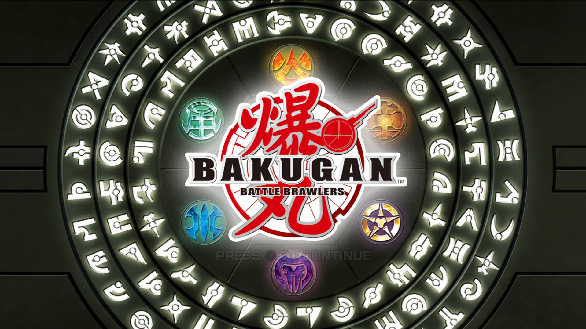
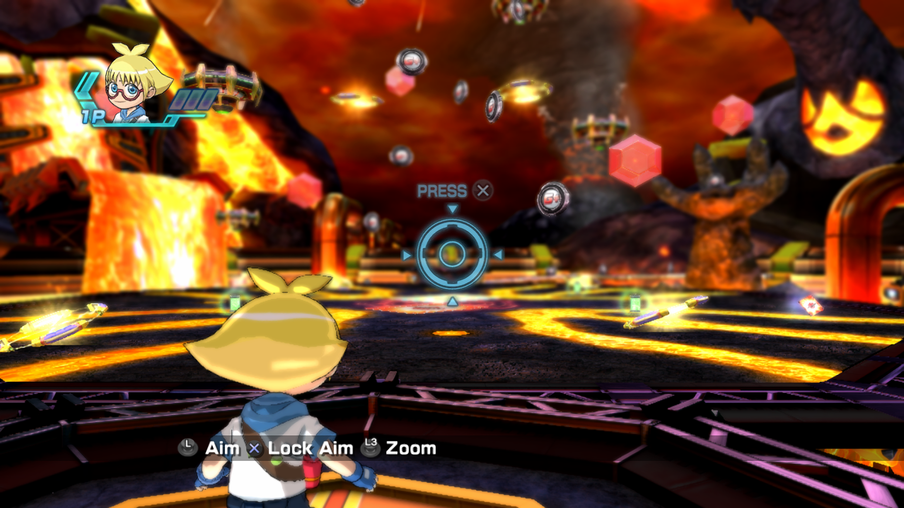
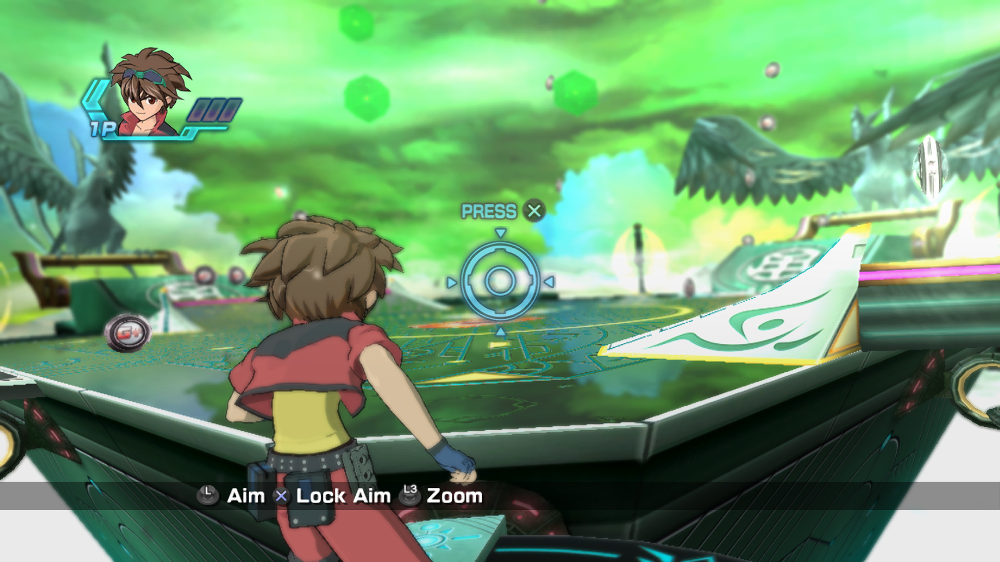

# Bakugan: Battle Brawlers — Native PS3 Recompilation for Windows

<strong>The PlayStation 3 release (<code>BLES00758</code>), statically recompiled into a native Windows x64 executable.</strong>

<a href="README.es.md"><strong>Versión en Español</strong></a> · 
<a href="#whats-new-and-fixes-v135">What's New (v1.3.5)</a> · 
<a href="#system-requirements">System Requirements</a> · 
<a href="#how-to-install-and-play">Installation Guide</a> · 
<a href="#controls-and-sixaxis">Controls & Sixaxis</a> · 
<a href="#credits-and-acknowledgments">Credits</a>

---

## Showcase

### Title Screen

### Battle Arena — Pyrus

### Battle Arena — Ventus

---

## Overview

[Bakugan: Battle Brawlers](https://en.wikipedia.org/wiki/Bakugan:_Battle_Brawlers) (2009) was originally released on consoles and never ported to PC. This project statically recompiles the PlayStation 3 version's **PPU (CPU)** and **SPU (DSP)** code directly into optimized 64-bit Windows C++ code using the **[PS3Recomp](https://github.com/sp00nznet/ps3recomp)** toolkit, linking against a lightweight High-Level Emulation (HLE) runtime that translates system calls to **Direct3D 12**, **WASAPI**, and **Windows threads**.

The game is **fully playable from start to finish**: story mode, tutorials, battle arenas, card minigames, cutscenes, FMVs, multiplayer (up to 7 ports), and saving/loading function natively.

---

## What's New and Fixes (v1.3.5)

> See the release notes in [docs/RELEASE_1.3.5.md](docs/RELEASE_1.3.5.md) and [docs/RELEASE_1.3.0.md](docs/RELEASE_1.3.0.md).

### D3D12 Performance & Graphics
- **AMD FSR 3.1 Frame Generation (Optical Flow)**: Interpolates 30 native FPS to ~60 presented FPS in compatible arenas with **HUD separation (`hudless`)** so menus, cards, and UI elements stay sharp without ghosting.
- **SMAA Antialiasing & FSR 1 Upscaling**: Full post-processing pipeline with **SMAA**, **AMD FSR 1.0 (EASU + configurable RCAS sharpness)** across 720p / 1080p / 1440p / 4K outputs, and **16x Anisotropic Filtering** (with a 2D mip-guard).
- **Unified Shader Disk Cache & Pipeline Optimizations**: Unified `fp_v4` / `vs_v1` shader disk cache in `%LOCALAPPDATA%\BakuganRecomp\shadercache`, hash-table lookups, **SRV dirty tracking** to skip redundant descriptor writes, and a **persistent font atlas** for overlays.
- **Display Modes & Diagnostics**: Native `windowed`, `borderless`, and DXGI `fullscreen` modes with exact **16:9 aspect ratio** preservation, instant window/borderless toggle via **`F11`**, and a real-time performance & settings diagnostics overlay via **`F12`**.

### Frame Pacing & 30 / 60 FPS Gameplay
- **144 Hz Frame-Pacing Fix**: Eliminated the 28.80 FPS quantization bug on 144 Hz displays, locking frame pacing to a steady **30.00 FPS**.
- **30 FPS Default & Optional 60 FPS Mode**: Runs at 30 native FPS by default (with optional FSR 3.1 interpolation up to ~60 presented FPS), while keeping optional native 60 FPS support (`PS3_FPS_CAP=60`) with the **battle pause / options menu** `Start`-button edge fix so pausing in combat works reliably.

### SPU Audio / MultiStream / WASAPI
- **SSSE3 SIMD Acceleration (~12x)**: Fast SSE float and SSSE3 local-store audio kernels for MultiStream DSP overlays.
- **Soft-Knee Peak Limiter & De-Click**: Dynamic peak limiting prevents audio clipping and distortion during intense multi-effect battles, paired with orphan slot cleanup and adaptive jitter cushioning.
- **SPU ACK Prioritization & Clean FMV Teardown**: Prioritized SPU mailbox ACKs avoid stalls during rapid attack bursts, and video/audio threads shut down cleanly during FMV cutscenes and window exit.

### Sixaxis, Launcher v1.3.5 & Installer
- **Refined Sixaxis & Analog Controls**: FPS-independent **EMA smoothing**, 2D radial deadzones, calibrated physical gyroscope support without double-tilting, **Hybrid mode** (combining right stick corrections with physical gyro), **Fast** profile as default, and progressive left-stick aiming across diagonals.
- **Dark Pyrus Launcher v1.3.5**: Bilingual dark Pyrus-themed UI (`BakuganLauncher.exe`) with an interactive controller map (`assets/launcher/Control.png` / Launcher-Picture), faithful `player.ini` persistence, smart cursor visibility/capture management, and an **`Esc`** exit confirmation dialog.
- **Zero-Dependency Static CRT & Safe Installer**: Built with the **static MSVC runtime (`/MT`)** so no external Visual C++ Redistributable is required. `Installer.cs` (`BakuganSetup.exe`) protects existing save data and `player.ini`, supports in-place upgrades from previous versions without re-copying the ISO, and repairs read-only disc files cleanly.

---

## System Requirements

| Component | Minimum Requirements | Recommended Specifications |
| :--- | :--- | :--- |
| **Operating System** | Windows 10 64-bit (Version 1909+) or Windows 11 | Windows 10/11 64-bit (latest update) |
| **Processor (CPU)** | **x86-64 with mandatory AVX2 and SSE4.1 support** *(Intel Core 4th Gen Haswell / AMD Ryzen 1000 series or newer)* | 6-Core / 12-Thread CPU with AVX2 *(Intel Core i5-10400 / AMD Ryzen 5 3600 or newer)* |
| **Memory (RAM)** | 4 GB RAM | 8 GB RAM or more |
| **Graphics (GPU)** | Direct3D 12 Feature Level 11_0 *(NVIDIA GeForce GTX 960 / AMD Radeon RX 460 / Intel Iris Xe)* | Direct3D 12 Feature Level 12_0 (for FSR 3.1 Frame Generation) *(NVIDIA GeForce RTX 2060/3050 / AMD Radeon RX 6600 or better)* |
| **Storage** | 6 GB available space (HDD supported) | 6 GB available space on SSD |
| **Audio** | Windows-compatible WASAPI audio device | Stereo / Multi-channel headphones or speakers |
| **Runtime Dependencies** | **None** (statically linked `/MT`; no VC++ Redistributable needed) | — |
| **Game Media** | Legally owned European retail PS3 disc dump (`BLES00758`) | `.iso` image or extracted `PS3_GAME` folder |

> [!NOTE]
> Release binaries are compiled with **SSE4.1** and **AVX2** enabled for the SPU audio/compute paths. CPUs without AVX2 or SSE4.1 support are not supported by the prebuilt binaries.

---

## Game Requirements (European Edition)

> [!IMPORTANT]
> This recompilation requires assets from the **European retail disc release of Bakugan: Battle Brawlers (`BLES00758`)**.
> Other regional releases (such as US `BLUS30409`) have distinct binary layouts and are not compatible with this lift.

You must provide your own legally dumped European disc image as an **ISO file (`.iso`)** or an extracted folder structure containing `PS3_GAME/USRDIR/EBOOT.BIN`.

---

## How to Install and Play

### Fresh Installation
1. Download the complete release archive **`Bakugan-Battle-Brawlers-Recomp-1.3.5-win64.zip`** from the [Latest Release](https://github.com/Mauryln/Bakugan-Battle-Brawlers-PS3-recomp/releases/latest).
2. Extract the entire ZIP archive into a folder of your choice (keep the `payload` folder beside `BakuganSetup.exe`).
3. Run **`BakuganSetup.exe`** from the extracted directory.
4. Select your **European Disc ISO (`BLES00758`)** or extracted `PS3_GAME` folder.
5. Choose your installation directory and shortcut preferences (Desktop / Start Menu), then click **Install**.
6. Launch the game from the shortcut or **`BakuganLauncher.exe`**, adjust graphics/controls, and click **Play**.

### Updating from a Previous Version (v1.2.0 / v1.3.0)
1. Close the game and `BakuganLauncher.exe`.
2. Extract the v1.3.5 ZIP archive and run **`BakuganSetup.exe`**.
3. Select your existing installation folder and **leave the ISO field blank**. The installer updates the binaries and launcher assets while reusing your decrypted game data and preserving your saves and `player.ini`.

---

## Controls and Sixaxis

The input bridge supports up to **7 simultaneous ports** across Keyboard, Mouse, and Gamepads (DualShock 4, DualSense, Nintendo Switch Pro, Xbox/XInput, and generic SDL3 controllers). Every binding can be customized visually in **`BakuganLauncher.exe`**.

### Default Keyboard, Mouse & System Shortcuts

| PS3 Action / Function | Default Key / Input | Game Function |
| :--- | :--- | :--- |
| **Cross (✕)** | `X` *(or Left Mouse Click)* | Confirm / Jump / Action |
| **Circle (○)** | `C` | Cancel / Back |
| **Square (□)** | `Z` | Attack / Ability card |
| **Triangle (△)** | `S` | Special / Gate card |
| **D-Pad & Left Stick** | Arrow Keys (`↑`, `↓`, `←`, `→`) | Menu Navigation / Character Movement / Aiming |
| **Right Stick** | `I`, `J`, `K`, `L` | Camera / Sixaxis Tilt |
| **Sixaxis Throw / Impulse** | `F` | Sixaxis Throw Impulse |
| **Start** | `Enter` | Pause / Options Menu |
| **Select** | `Tab` | Status / Map / Details |
| **L1 / R1** | `Q` / `E` | Switch cards / Camera zoom |
| **L2 / R2** | `1` / `2` | Secondary actions / Card preview |
| **L3 / R3** | `3` / `R` | Stick click actions |
| **Sixaxis Steering** | **Mouse Motion** / Right Stick / Physical Gyro | Steer Bakugan ball in battle arenas |
| **Display Toggle** | `F11` | Instant Windowed ↔ Borderless toggle |
| **Diagnostics Overlay** | `F12` | Toggle real-time FPS / frame-time / config overlay |
| **Exit Confirmation** | `Esc` | Open exit confirmation dialog |

### Sixaxis Motion Implementation

Three motion input methods work seamlessly and can be tuned in `BakuganLauncher.exe` (with the **Fast** profile active by default):

- **Mouse Steering**: Natural mouse tilt with FPS-independent EMA smoothing, radial deadzone, and automatic return-to-center physics. Cursor capture adapts cleanly to menus, overlays, and Alt-Tab.
- **Right Analog Stick**: Smooth 360° ball steering for standard controllers, plus progressive aiming response on the left stick.
- **Physical Gyroscope & Hybrid Mode**: Calibrated native motion sensor support via SDL3 on DualShock 4, DualSense, and Switch Pro controllers without double-tilting. In **Hybrid** mode, you can fine-tune or correct steering with the right stick even while tilting the controller.

---

## Technical Details

- **Ahead-of-Time Static Recompilation**: 15,682 PPU functions and 1,331 SPU functions compiled to native x64 code with LLVM `clang-cl` `/O2` and static CRT (`/MT`).
- **SIMD-Accelerated SPU Paths**: SSE4.1 / AVX2 SPU helpers and SSSE3 / SSE-float MultiStream audio kernels.
- **Direct3D 12 HLE**: Custom RSX command buffer translator with parallel vertex upload workers, SRV dirty tracking, unified shader disk cache (`fp_v4`/`vs_v1`), SMAA, AMD FSR 1.0, and AMD FSR 3.1 Frame Generation with HUD separation.
- **Low-Latency WASAPI Audio**: Multi-stream mixing with soft-knee peak limiting, adaptive jitter buffering, and prioritized SPU ACKs.
- **Save Data & Config Location**: Saves live in `%LOCALAPPDATA%\BakuganRecomp\dev_hdd0\home\00000001\savedata`; player settings live in `%LOCALAPPDATA%\BakuganRecomp\player.ini`.

---

## Credits and Acknowledgments

This port would not exist without the open-source emulation and recompilation community:

- **PS3Recomp Team & Ned Heller ([sp00nznet](https://github.com/sp00nznet) / [arnold9401](https://github.com/arnold9401))**:  
  Heartfelt thanks to the creators of the **[PS3Recomp](https://github.com/arnold9401/ps3recomp)** static recompilation framework. Their research into PPU/SPU translation and PS3 HLE runtime design made this native Windows port achievable.
- **RPCS3 Developers ([rpcs3.net](https://rpcs3.net))**:  
  For their PS3 emulator and portable decryption utilities used for disc asset extraction.
- **libsdl-org ([SDL3](https://github.com/libsdl-org/SDL))**:  
  For cross-platform controller enumeration and physical motion sensor handling.
- **AMD FidelityFX**:  
  For official FSR 1.0 (EASU + RCAS) and FSR 3.1 Frame Generation (Optical Flow).

---

## Legal & Disclaimers

Bakugan: Battle Brawlers is © Activision, Nowpro, Nelvana, Spin Master, and Sega Sammy.  
This project is an independent open-source recreation and is **not affiliated with, endorsed by, or sponsored by Sony Interactive Entertainment, Activision, or copyright holders**.

**NO COPYRIGHTED ASSETS, CODE, CIPHER KEYS, DISC IMAGES, OR LIFTED GAME DATA ARE DISTRIBUTED HERE.**  
Users must legally acquire and provide their own retail European PlayStation 3 disc (`BLES00758`).
