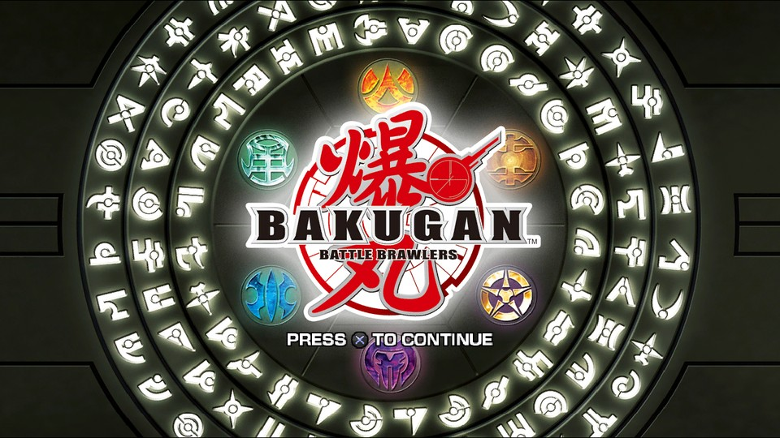
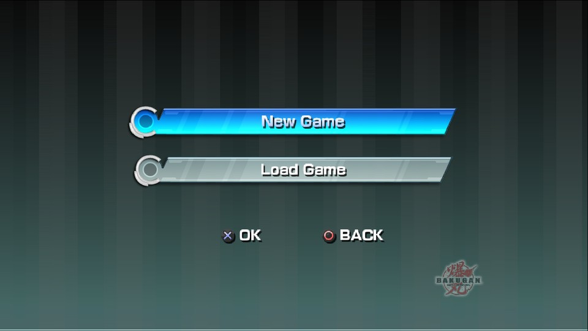
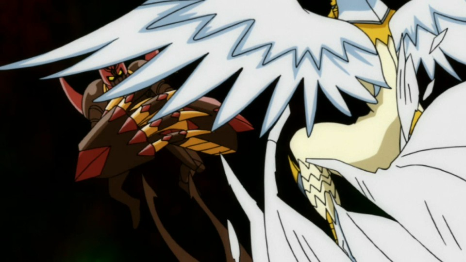

<div align="center">



<h1>Bakugan: Battle Brawlers — native PS3 recompilation for Windows</h1>

<p><strong>The PlayStation 3 release (<code>BLES00758</code>), statically recompiled into a native Windows x64 executable.</strong><br>
No emulator. No Xbox 360 code. No Linux.</p>

<p>


</p>

<p><a href="README.es.md">Español</a> · <a href="docs/STATUS.md">Status</a> · <a href="docs/VIDEO.md">Video pipeline</a> · <a href="docs/ARCHITECTURE.md">Architecture</a> · <a href="CONTRIBUTING.md">Contributing</a></p>

</div>

[Bakugan: Battle Brawlers](https://en.wikipedia.org/wiki/Bakugan:_Battle_Brawlers) (2009) was never ported to PC. This project lifts the game's **PPU (CPU) and SPU (DSP) code to C++ ahead of time** with [ps3recomp](https://github.com/sp00nznet/ps3recomp) and links it against a small HLE runtime, producing an ordinary `.exe` that renders through Direct3D 12 at 30 FPS.

Nothing runs in an emulator: the machine code is translated once, then compiled like any other program.

| | |
|---|---|
|  |  |
| Title flow, save-data warning, loading, new game / load game | Narrative intro — H.264/AAC decoded through Media Foundation |

## Status

| Milestone | |
|---|---|
| Disc analysis — 12,834 OPD functions, 195 imports, 14 libraries | ✅ |
| PPU lift — 15,682 functions / 17 translation units | ✅ |
| SPU lift — 5 images, 1,331 functions | ✅ |
| HLE table — 1,204 handlers | ✅ |
| Build — clang-cl + Ninja + Direct3D 12, 30 FPS | ✅ |
| Asset pipeline — 607 inflate jobs decompressed on the SPUs | ✅ |
| Publisher FMVs — Activision, Nowpro, Premium Agency, Nelvana | ✅ |
| Opening + narrative intro — H.264/AAC through Media Foundation | ✅ |
| Title screen, all menus, mode select, 2D textures | ✅ |
| In-game keyboard (name entry) and keyboard/XInput pad | ✅ |
| Music — `SNDP` PCM scores mixed by the SPU, plus FMV AAC | ✅ |
| Battle Arena — slow to load, then starts a duel | ⚠️ |
| *Known defect:* mode-select "gate" — 2D layers behind the portrait overlap | ⚠️ |
| **3D scene** — cinematics render (textures still grainy); the player's turn goes black | ⚠️ |
| **Gameplay** — tutorial, story battles | ❌ |
| **Sound effects** — ATRAC3 in `SOUND/*.PAST` | ❌ |

If you only read one line: **the game boots, plays its videos (with music), shows every menu, starts a Battle Arena duel, and the 3D scene renders in cinematics — but the player's turn is still black.**

## Help wanted

These are the walls we are stuck on. Each one is a self-contained problem with a measurement already done — the details are in [`docs/STATUS.md`](docs/STATUS.md) and [`docs/NEXT_SESSION.md`](docs/NEXT_SESSION.md).

1. **The 3D scene.** Battle Arena submits 438–600 draws per frame into the 1120×584 2× MSAA target (`0xEAB0000`) and the target does receive content. The strip-restart fix (`patches/0009`) removed the deformation, and the render-target rebind + shader cache (`patches/0010`) fixed the cinematic black screen and the shader-compile freezes. What remains is the **player's turn going black** (the composite samples the scene target but leaves no pixels), plus grainy textures and invisible faces. See [`docs/NEXT_SESSION.md`](docs/NEXT_SESSION.md) for the exact next test.
2. **Audio leftovers.** Menu scores and the SPU mixer work; the `.PAST` effects are ATRAC3 and still silent, and a few cuts are under review. `libs/audio/`.
3. **Testers.** Does it boot on your GPU/driver? A `run.log` and one sentence is enough to open an issue.

Partial work, wrong guesses and "this is how RPCS3 does it" are all welcome — open an issue first if you plan something large.


## How it works

```
iso/*.iso  ──extract_iso──▶  game/  ──EBOOT decrypt──▶  EBOOT.elf
                                                        │
                             analysis/  ◀──ppu_loader────┘
                                 │
                    ┌────────────┴─────────────┐
              lift PPU (17 TUs)          lift SPU (5 images)
                    │                          │
                    └────────────┬─────────────┘
                          bakugan-recomp/
                                 │  + HLE runtime (ps3recomp toolkit)
                                 ▼
                     BakuganRecomp.exe  ──D3D12──▶  your monitor
```

**Everything generated is rebuilt from your own disc dump.** This repository contains no game code, no assets, no keys and no lifted sources — see [Legal](#legal).

## Build it

Requirements: Windows 10/11 x64 with Direct3D 12, Python 3.10+, and **Visual Studio 2022 Build Tools** with *Desktop development with C++* and the *C++ Clang Compiler for Windows* component. About 15 GB free.

```powershell
# 1. Your own disc dump
#    put "Bakugan - Battle Brawlers (Europe).iso" in iso/

# 2. Python environment
python -m venv .venv
.\.venv\Scripts\python.exe -m pip install -r ps3recomp-src\requirements.txt
.\.venv\Scripts\python.exe -m pip install cmake ninja

# 3. The toolkit, pinned to the commit our patches apply to
git clone https://github.com/sp00nznet/ps3recomp.git ps3recomp-src
git -C ps3recomp-src checkout a6d76c8

# 4. Regenerate everything (ISO -> ELF -> analysis -> lifts -> HLE table)
.\.venv\Scripts\python.exe tools\pipeline.py

# 5. Compile and run
.\.venv\Scripts\python.exe tools\build.py
.\tools\run.ps1
```

`pipeline.py` also applies [`patches/`](patches) to the toolkit checkout, so step 3 is enough to reproduce our runtime changes. Use `--only <step>` for a single stage or `--force` to redo everything; the step list prints on `--help`.

**Controls:** `X` / Space = Cross (confirm) · `C` `Z` `S` = Circle / Square / Triangle · arrows = D-pad · `Enter` = Start · `Q` `E` = L1/R1 · `1` `2` = L2/R2.

## Repository layout

| Path | What it is |
|---|---|
| `bakugan-recomp/` | The port: entry point, HLE stubs, D3D12 movie path, CMake build |
| `patches/` | Our changes to the ps3recomp toolkit, applied by the pipeline |
| `tools/` | Pipeline, build, launch and diagnostic scripts |
| `docs/` | Status, video pipeline, architecture |
| `ps3recomp-src/`, `game/`, `analysis/`, `bakugan-recomp/recompiled/` | Generated or upstream — **not** versioned |

## Diagnostics

Every fix in this project started as a measurement, and the knobs are still there: `RSX_CAP` (frame capture with a draw manifest), `RTT_STAT`, `VDEFDBG`, `VTXALLF`/`VTXGATE` (per-draw bounds), `VPSEL`, `FLIPPC`, `NODEPTH`, `MTDBG`. They are environment variables, off by default, documented where they are defined.

## Legal

Bakugan: Battle Brawlers is © its rights holders. This repository ships **no game code, no assets, no encryption keys, no lifted sources and no binaries**. You must own the disc. The port's own code is MIT licensed; the toolkit is MIT by Ned Heller / sp00nznet — see [CREDITS.md](CREDITS.md) and [LICENSE](LICENSE).
