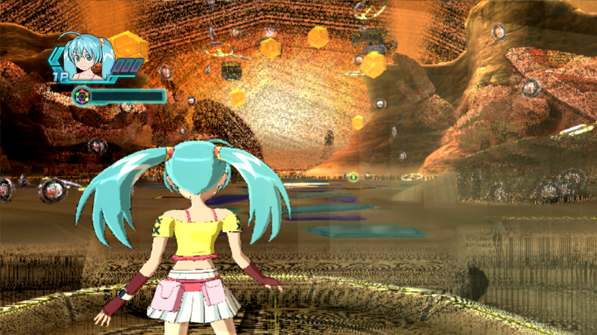
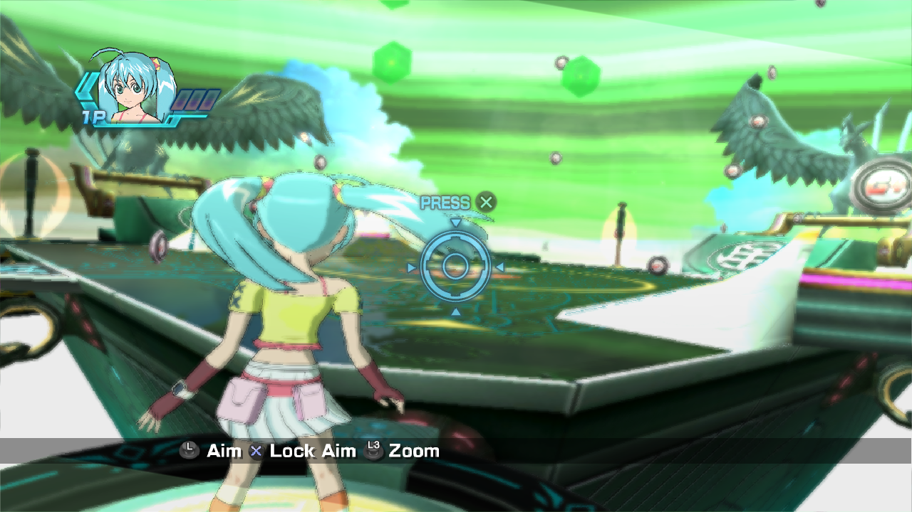
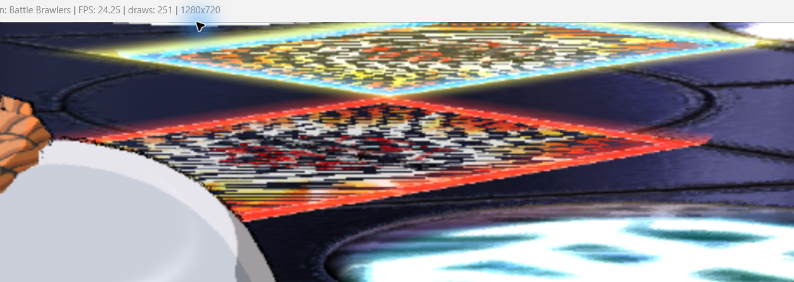
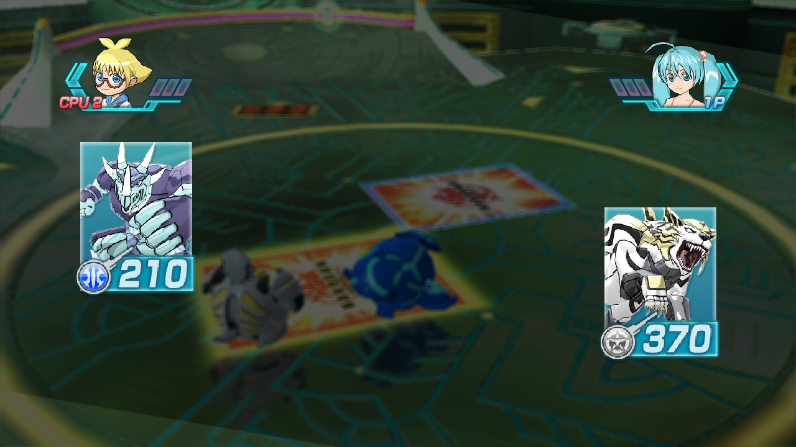

# Fixed: Battle Arena gameplay, campo y cartas — 31/10/2026

Battle Arena supera `GAME START`, entra al turno del jugador y continúa al turno
de la CPU. Se corrigieron el granulado/agujeros del campo y las bandas de las
cartas. El usuario confirmó ambas correcciones visuales al cerrar la sesión.
El siguiente trabajo es sobre **efectos y shaders**: este anuncio no significa
que todo el renderizado, todos los modos o el rendimiento estén terminados.

Rama: `codex/battle-arena-rendering`. Continuar por
[NEXT_SESSION_EFFECTS_SHADERS.md](NEXT_SESSION_EFFECTS_SHADERS.md).

## Correcciones conservadas

| Parche | Problema y solución |
|---|---|
| `0026-gcm-flip-wrap-backpressure.patch` | El flip rebobinaba `ctx->current` al inicio con solo un margen de cabecera consumida. El productor podía sobrescribir comandos/saltos aún pendientes. Se elimina ese reciclado anticipado: el flip avanza normalmente y el callback de buffer lleno publica el salto, espera a consumir la cola y después reutiliza el inicio. |
| `0027-d3d12-texture-source-pitch.patch` | El backend perdía `TEXTURE_CONTROL3.pitch` al guardar el draw y al subir texturas. Ahora lo conserva en todos los caminos y en la clave de caché. Las texturas lineales, también BC3, mantienen el pitch en sus mips; la copia de bloques salta el padding de origen y escribe solo los bytes útiles de cada fila. |
| `0028-d3d12-alpha-test-precision.patch` | El campo usaba `GEQUAL` con referencia `255/255`. Un alfa interpolado ligeramente inferior a 1 se descartaba, produciendo puntos negros y agujeros. En targets RGBA8 UNORM/sRGB se compara el alfa redondeado a 8 bits. Los targets flotantes conservan la comparación original; el color exportado y el blending no se modifican. |

Se conservan `0024` (capturas limitadas a una cada 500 ms) y `0025`
(diagnóstico/recuperación del FIFO). La serie contiene **27 archivos de parche**:
`0001`–`0028`, sin `0023`, que continúa revertido.

## Evidencia visual

Las capturas del campo son de arenas y cámaras distintas; documentan el defecto
y el resultado, no una comparación exacta de píxeles.

| Campo anterior | Campo corregido, turno del jugador |
|---|---|
|  |  |

| Cartas anteriores | Cartas y combate corregidos |
|---|---|
|  |  |

## Validación

- `tools/build.py`: compilación Windows correcta.
- **15/15 pruebas**: todos los `tools/test_rsx_*.py`, más
  `test_gcm_fifo_wrap.py` y `test_pipeline_patches.py`.
- Nueva prueba FIFO: ejecuta las funciones reales con un consumidor retrasado;
  verifica que el flip no reutilice el inicio ni ejecute su finalización antes
  de registrar la petición, y que el callback espere al salto.
- Prueba BC3: footprints reales de D3D12, tamaños **204×120 y 228×300**, pitch
  de origen con padding y dos mips; comprueba bloques, padding y límites.
- Nueva prueba de alfa: renderiza con D3D11 WARP shaders generados por el
  decompilador y el helper real de D3D12. Cubre salidas FP16/FP32, uno/varios
  targets, alfa casi opaco, recortes y targets flotantes.
- Clone local limpio del toolkit en `a6d76c895f77eb30b90a806c830544e61821b77f`:
  `git apply` de los 27 parches correcto. Los fuentes reconstruidos coinciden
  con el checkout salvo el diagnóstico opcional `VTX_COL`, anterior a esta sesión.
- En juego: `GAME START`, turno 1P, lanzamiento/`STAND`, turno CPU y entrada
  al enfrentamiento, sin nuevos resyncs ni avisos de reciclado detenido en la
  corrida final. Captura con textura BC3 lineal 228×300 registrada en el manifest.

Repetir desde PowerShell:

```powershell
.\.venv\Scripts\python.exe tools\pipeline.py --only patch
.\.venv\Scripts\python.exe tools\build.py
.\.venv\Scripts\python.exe tools\test_gcm_fifo_wrap.py
.\.venv\Scripts\python.exe tools\test_rsx_texture_mips.py
.\.venv\Scripts\python.exe tools\test_rsx_alpha_precision.py
.\tools\debug_run.ps1 -Tag effects-next -Capture
```

## Investigación y límites

La prueba temporal `DEPTH_OFF=1` rompía la oclusión de los personajes y no quitaba
el granulado. Fue descartada; la validación final usa profundidad normal.
También se descartó esperar al reciclado dentro del propio flip: podía consumir
su marcador antes de armar la secuencia de finalización. La solución final deja
el reciclado al callback normal; no conserva esa espera experimental.

Se extrajeron texturas y shaders de la memoria del proceso para contrastar los
datos. Las muestras de color/normal del campo eran válidas. La prueba en GPU
reprodujo el descarte de alfa casi opaco y pasó con el redondeo UNORM.
No se reescribió el decodificador BC3 ni se reintrodujo la sombra falsa de `0023`.

Referencias consultadas: disposición de filas y mips lineales en
[TextureUtils.cpp de RPCS3](https://github.com/RPCS3/rpcs3/blob/master/rpcs3/Emu/RSX/Common/TextureUtils.cpp)
y tratamiento del alfa/ROP en
[RSXROPEpilogue.glsl](https://github.com/RPCS3/rpcs3/blob/master/rpcs3/Emu/RSX/Program/GLSLSnippets/RSXProg/RSXROPEpilogue.glsl).
Este último identifica el redondeo como comportamiento inferido a partir de
juegos; no se hizo una prueba nueva en hardware PS3 en esta sesión.

La corrida final con diagnósticos/capturas estuvo aproximadamente a **9–12 FPS**.
Esto no es una medición comparable sin diagnósticos ni una mejora de rendimiento.
Quedan efectos, shaders, sombras reales y rendimiento por investigar.

Los dumps completos permanecen locales en `diagnostics/arena/alpha-final/`
(`run.err`, `run.out`, `frame_100`–`frame_103` y posibles capturas posteriores).
Las pruebas y logs están en `diagnostics/arena/*-final.log`. No se suben dumps
de memoria, shaders extraídos, assets del juego, ejecutables ni el toolkit anidado.
